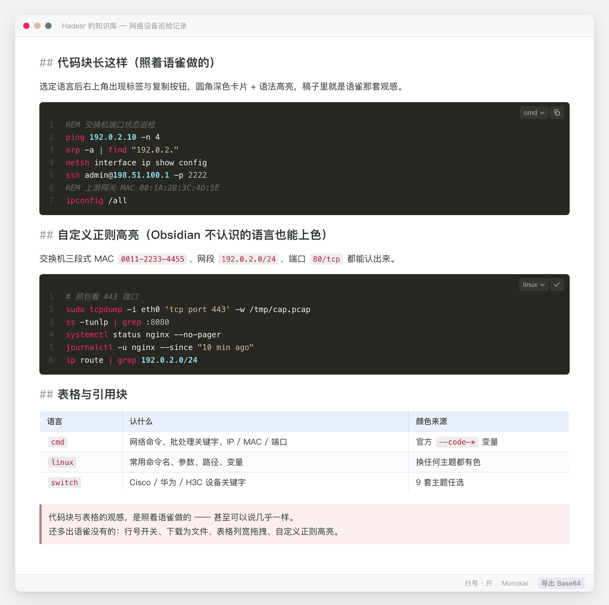
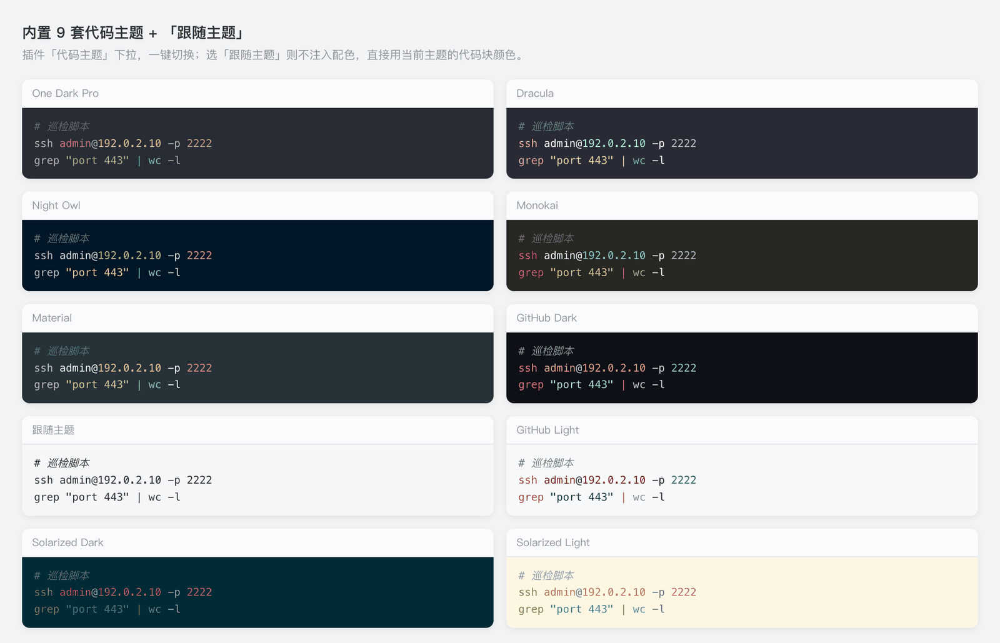

# Code-UI

> Obsidian 两件套：**代码块 / 表格增强插件** + **配套界面主题**。放这个仓库，方便多台电脑用 `git pull` 保持同步。

| 资产 | 名字 | 版本 | 干什么的 |
|---|---|---|---|
| 插件 | **Hadesr Code** | `v2.25.8` | 代码块工具栏（语言 / 主题 / 复制 / 下载 / 行号）、代码块配色与字体、**自定义正则高亮**、表格工具栏（含**复制表格**）、表格列宽拖拽、引用块换色档位、表格配色档位 |
| 主题 | **Hadesr UI** | `v1.4.0` | 代码块 / 表格 / 引用块的整套观感，**任务清单已完成项删除线**，**基于 Blue Topaz 精简改造** |

---

## 为什么推荐它：代码块照着语雀做

**这套代码块的观感，是照着语雀做的 —— 甚至可以说几乎一样。**



| 语雀的代码块 | 这里的代码块 |
|---|---|
| 右上角**语言标签**（点开切语言） | ✅ 同款 |
| 右上角**复制按钮** | ✅ 同款（点一下，图标变 ✓） |
| **圆角卡片 + 深色底** | ✅ 同款 |
| **语法高亮配色** | ✅ 内置 **9 套**主题，也能跟随主题 |
| **表格**：浅蓝表头 + 细框线 | ✅ 同款（**6 档**配色） |
| **引用块**：左竖条 + 浅底 | ✅ 同款（**5 档**颜色） |

> 在 Obsidian 里拿到语雀那套观感，**还多出**：行号开关、下载为文件、表格列宽拖拽、自定义正则高亮。

### 内置 9 套代码主题



`One Dark Pro` · `Dracula` · `Night Owl` · `Monokai` · `Material` · `GitHub Dark` · `GitHub Light` · `Solarized Dark` · `Solarized Light`

外加 **「跟随主题」** 档 —— 不注入任何配色，直接用当前主题自己的代码块颜色。

---

## 新电脑安装（3 步）

### 1. 拿文件

```bash
git clone https://github.com/Hadesls/CodeUI-Ob.git
cd CodeUI-Ob
```

### 2. 一键装进 vault

```bash
./install.sh "/path/to/你的vault"
```

脚本会把 `hadesr-code/` 和 `themes/Hadesr UI/` 拷进 vault，并自动写好启用登记。

> **手机 / iOS 提示**：系统「文件」App 看不到 `.obsidian`（隐藏目录）。建议在电脑上拷好，再用同步工具（Syncthing / iCloud / WebDAV）把整个 vault 同步过去。

### 3. 在 Obsidian 里确认

1. 设置 → 第三方插件 → 启用 **Hadesr Code**
2. 设置 → 外观 → 主题 → 选 **Hadesr UI**
3. 随便打开一篇笔记，确认：代码块有工具栏、引用块有竖条、表格有配色、**勾选完成的任务有删除线**

---

## 功能一览

| 功能 | 说明 |
|---|---|
| **代码块工具栏** | 语言切换 / 主题切换 / 复制 / 下载 / 行号开关 / 更多菜单（同步语言到全文等） |
| **★ 自定义正则高亮** | 给 Obsidian 不认识的语言上色（详见下节） |
| **表格工具栏** | 复制表格（Markdown 格式，只读不改文档）/ 上方插行 / 删除本行 / 下方插行 / 左侧插列 / 删除本列 / 右侧插列 / 本列对齐 / 删除整表 |
| **表格列宽拖拽** | 拖表头分隔线调宽度，**按表记忆** |
| **引用块换色** | **5 档**：暖金 / 浅蓝 / 青绿 / 珊瑚红 / 暖灰 —— 换色 = 竖条 + 底色**整套换** |
| **表格配色** | **6 档**：主题默认 / 雾蓝全框线 / 浅蓝强调 / 斑马蓝 / 深蓝表头 / 暖金 |
| **代码主题** | **9 套** + 「跟随主题」 |
| **字体与字号** | 正文 / 代码块各两组下拉；**字号默认 16px，编辑态与阅读态一致** |
| **行号** | 三级控制：全局 / 按文件 / 按块 |

### ★ 自定义正则高亮（重点）

Obsidian 内置语言是**固定**的（阅读态 Prism 371 种 / 编辑态 CodeMirror 122 种），
`cmd` / `bat` / `linux` / 网络设备命令这些**都不在里面** —— fence 写出来一点颜色都没有。
本插件自带一套**轻量正则着色引擎**补这个缺口。

**内置规则包**（开箱即用，不用配）：

| 类别 | 认什么 |
|------|--------|
| 网络标识 | IP（含 CIDR `192.0.2.0/24`）、MAC（**六段 `00:1A:2B:3C:4D:5E` 与三段 `0011-2233-4455` 都认**）、端口（`:8080`、`80/tcp`、`port 8080`） |
| **网络命令名** | `ping` `tracert` `nslookup` `ipconfig` `ifconfig` `netstat` `netsh` `route` `arp` `ssh` `curl` `wget` `dig` `tcpdump` `nmap` … |
| **网络设备关键字** | `show` `display` `interface` `vlan` `switchport` `trunk` `ospf` `bgp` `acl` `nat` `ip address` `undo` `system-view` … |
| Windows 批处理 | `if` `for` `goto` `call` `set` `echo` `copy` `move` `del` `find` `taskkill` `net` `reg` … |
| Linux 命令名 | `ls` `grep` `sed` `awk` `chmod` `systemctl` `journalctl` `df` `tar` `docker` `kubectl` `apt` … |
| 通用 | 注释 / 字符串 / 命令行参数（`-ano`）/ 变量（`$VAR` `%VAR%` `!VAR!`）/ 路径 / 数字 |

**能触发它的语言名**（都在语言下拉里，直接选即可）：

`cmd` · `bat` · `linux` · `switch` · `cisco` · `huawei` · `h3c` · `ios` · `network` · `vrp`

**自定义规则**（设置 → 自定义代码高亮）：每行一条 `语言 | token类型 | 正则`

```text
nginx  | keyword | \b(?:server|location|proxy_pass|listen|upstream)\b
nginx  | string  | \b(?:\d{1,3}\.){3}\d{1,3}:\d+\b
mycmd  | keyword | \b(?:foo|bar)\b
```

- 语言可写多个（逗号分隔）；`*` = 通用（对所有被接管的语言生效）
- token 类型：`keyword / comment / string / number / cmd / option / variable / path / ip / mac / port / op`，颜色取自官方 `--code-*` 变量 → **换任何主题都有色**
- **只有你写了规则的语言才会被接管** —— `bash` / `js` / `python` 这些原生高亮不受影响

**边界（必读）**：

- ✅ 只作用于**阅读视图** + **实时预览里没聚焦的代码块**
- ❌ **编辑态（光标停在块内）不生效** —— 那块由 Obsidian 自己的 CodeMirror 渲染，插件不介入
- 超大块（>600 行 / 40KB）跳过，避免逐行正则拖慢

---

## 更新（另一台电脑 / 本机升级）

```bash
cd CodeUI-Ob
git pull
./install.sh "/path/to/你的vault"     # 覆盖式安装
```

然后在 Obsidian 里**重载**：`Ctrl/Cmd + R`，或到设置里把插件关掉再打开。

> 插件版本会显示在 **设置 → Hadesr Code** 的标题上（例如 `Hadesr Code 设置 v2.25.8`）—— 一眼就能看出这台是不是旧的。

---

## 目录结构

```
Code-UI/
├─ README.md                  ← 本文件
├─ CHANGELOG.md               ← 版本改动记录（插件 / 主题分开小节）
├─ install.sh                 ← 一键装进目标 vault
├─ LICENSE                    ← MIT（含 Blue Topaz 署名）
├─ hadesr-code/               ← 插件本体（= Obsidian 插件目录里的内容）
│  ├─ main.js
│  ├─ styles.css
│  ├─ manifest.json
│  └─ versions.json
├─ themes/
│  └─ Hadesr UI/              ← 主题
│     ├─ manifest.json
│     ├─ theme.css            ← 成品（底子 + 覆盖层合并，约 1.29 MB）
│     └─ overlay.src.css      ← 覆盖层源码（改样式改这里）
├─ docs/                      ← README 里的配图
│  ├─ preview-overview.png
│  └─ preview-themes.png
└─ theme-src/                 ← 主题重建原料（只给"要改主题"的人用）
   ├─ base-Blue-Topaz.css     ← Blue Topaz 底子（原样留档，别再动它）
   └─ rebuild-theme.py        ← 一键重合并：底子 + overlay.src.css → theme.css
```

> **不进仓库的东西**：插件目录里的 `data.json` —— 那是每台机器各自的设置（代码主题选择、引用块档位、表格档位、列宽记忆），由 Obsidian 自动生成。

---

## 开发 / 维护

**同步方向永远是单向**：本地 vault 是「开发机」，本仓库是「发行版」。
不要反向改仓库再拷回 vault，否则两边内容会飘。

```
① 在 vault 里改插件 / 主题覆盖层（就地改，马上能看到效果）
② 升版本号（插件 manifest + 主题 manifest + overlay 抬头）
③ 重合并主题成品（改过 overlay.src.css 才需要）：python3 rebuild-theme.py
④ 把改动同步到本仓库目录
⑤ git commit -m "feat: xxx（v2.25.8）" && git tag v2.25.8 && git push --tags
⑥ 别的电脑：git pull → ./install.sh → 重载 Obsidian
```

> 更细的说明（含主题"底子 + 覆盖层"的合并原理、重建步骤）见配套文档 **《Code-UI 打包与维护方案》**。

---

## 许可

**MIT License** —— 详见 [LICENSE](LICENSE)。

> 主题 `Hadesr UI` 基于 **Blue Topaz** 改造，按上游许可要求声明：
>
> *Partial style(s) is(are) sourced or adapted from Blue Topaz (https://github.com/PKM-er/Blue-Topaz_Obsidian-css), and I would like to express my appreciation to WhyI (https://github.com/whyt-byte) and pkmer.cn (https://pkmer.cn).*
